<div align="center">

# 🩺 UCAD Medical

### La santé universitaire, connectée et accessible

Plateforme de gestion des services médicaux de l'Université Cheikh Anta Diop de Dakar

*Direction artistique « Premium Institutional Healthcare » · vert profond + or · clair & sombre*

<br />

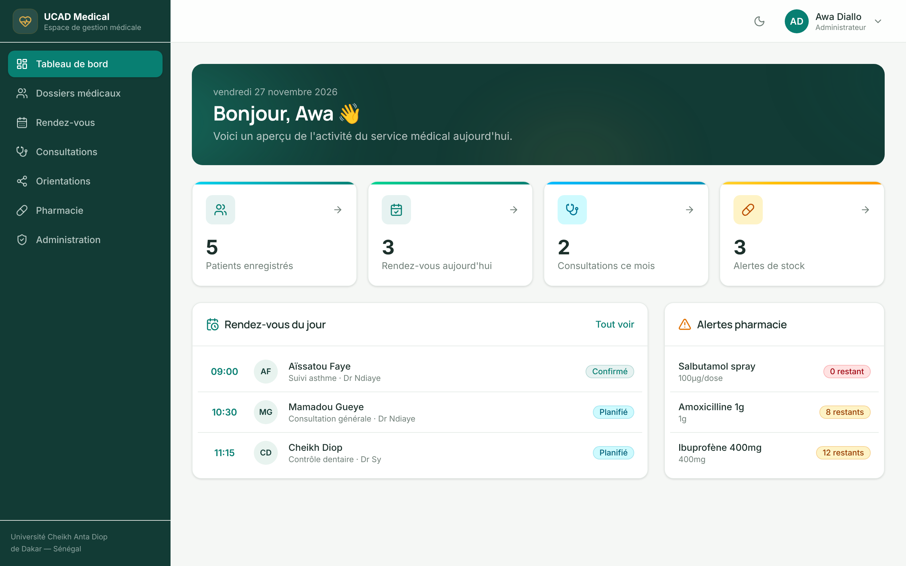

<br />


</div>

---

## 📖 Présentation

**UCAD Medical** est une application web **full-stack** qui numérise l'ensemble du parcours de soin
du service médical universitaire. Elle réunit deux interfaces dans une seule base de code :

- un **espace personnel** pour les soignants et l'administration (dossiers, rendez-vous, consultations, pharmacie) ;
- un **espace étudiant**, pensé **mobile-first** et **installable comme une application** (PWA), où chaque étudiant prend ses rendez-vous et consulte son dossier.

---

## 🖼️ Aperçu

### Accueil immersif & connexion

| Accueil (parcours 3D) | Connexion |
|:---:|:---:|
| 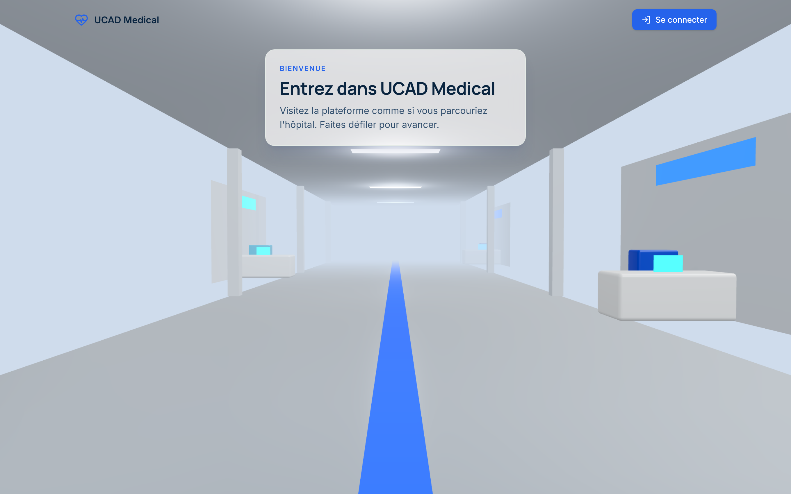 | 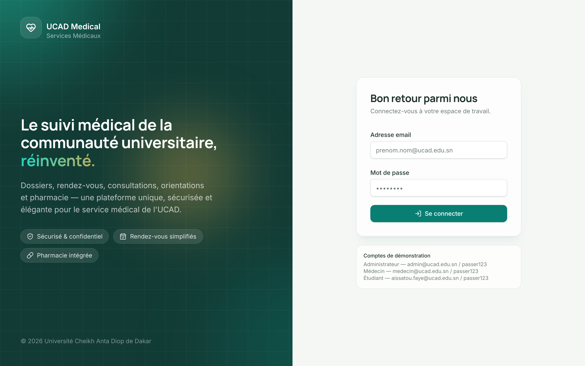 |

### Espace personnel (soignants & administration)

| Dossiers médicaux | Fiche patient |
|:---:|:---:|
| 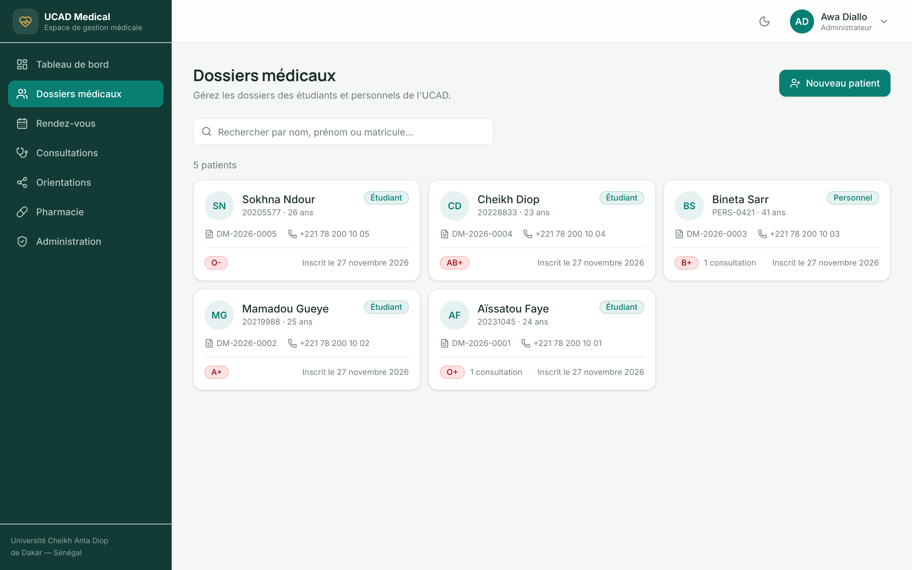 | 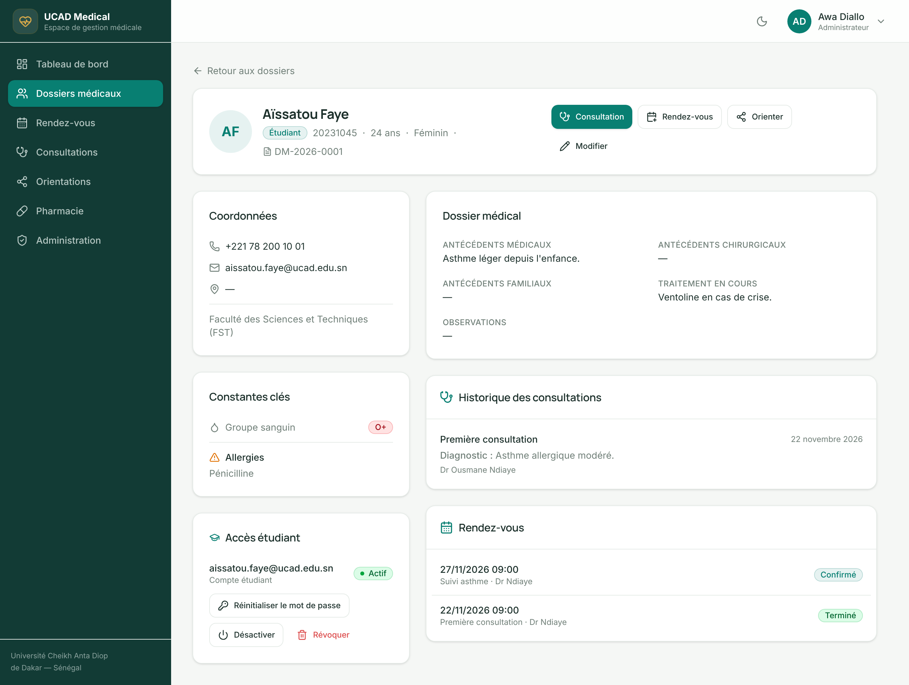 |

| Rendez-vous | Pharmacie |
|:---:|:---:|
| 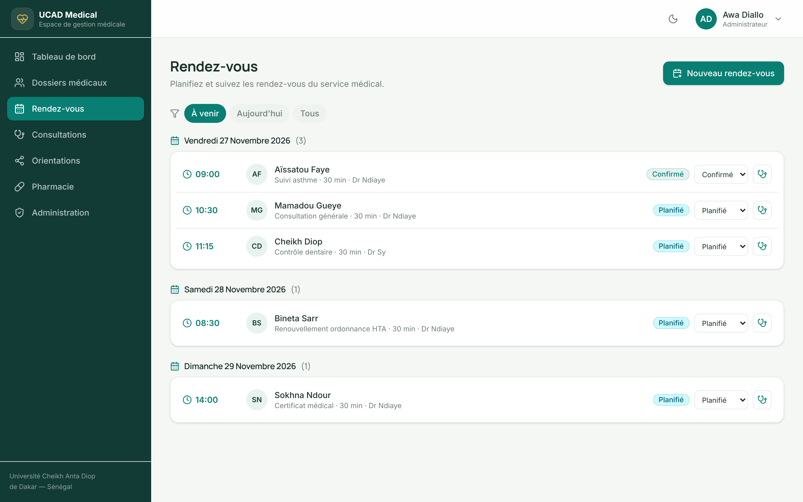 | 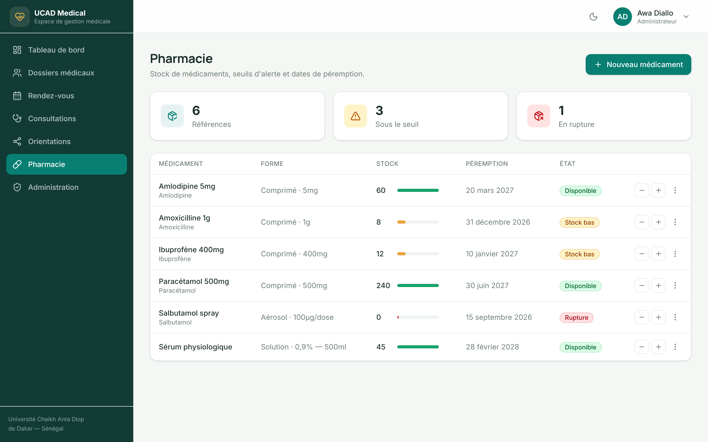 |

| Administration (comptes & rôles) |
|:---:|
| 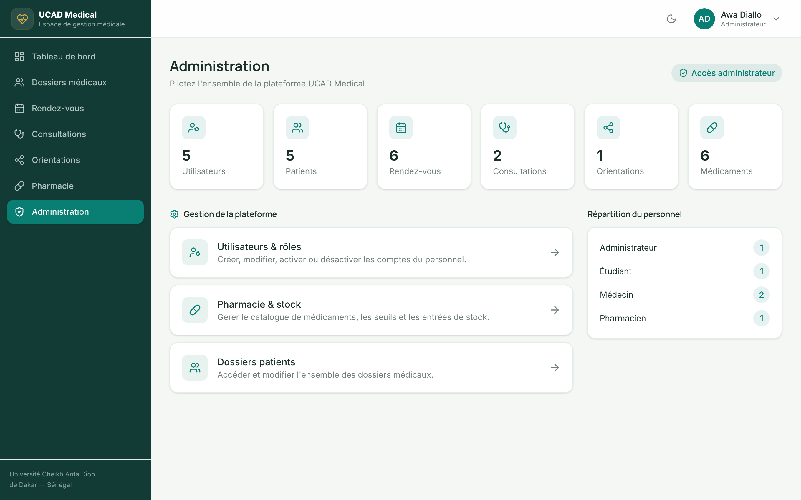 |

### Espace étudiant — PWA mobile

<div align="center">
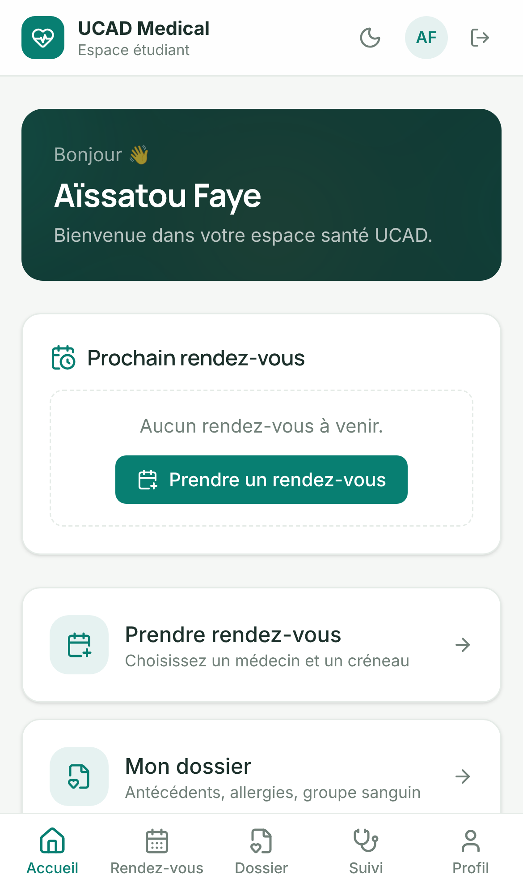
&nbsp;&nbsp;
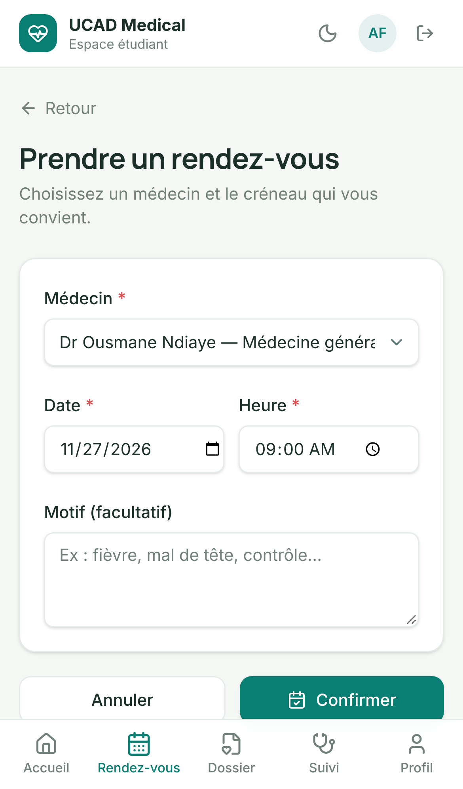
&nbsp;&nbsp;
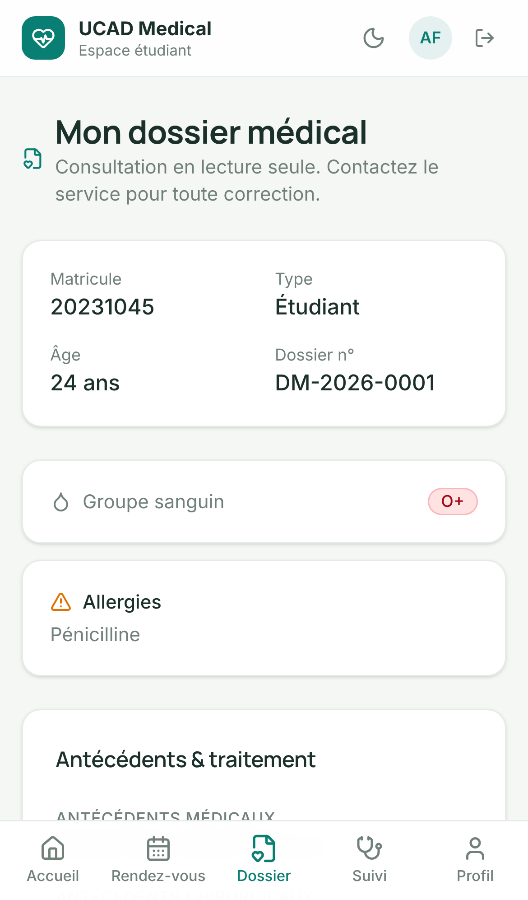
</div>

### 🌙 Mode sombre

L'interface propose un **thème clair et un thème sombre**, avec mémorisation du choix de l'utilisateur.

| Tableau de bord (sombre) | Pharmacie (sombre) | Étudiant (sombre) |
|:---:|:---:|:---:|
| 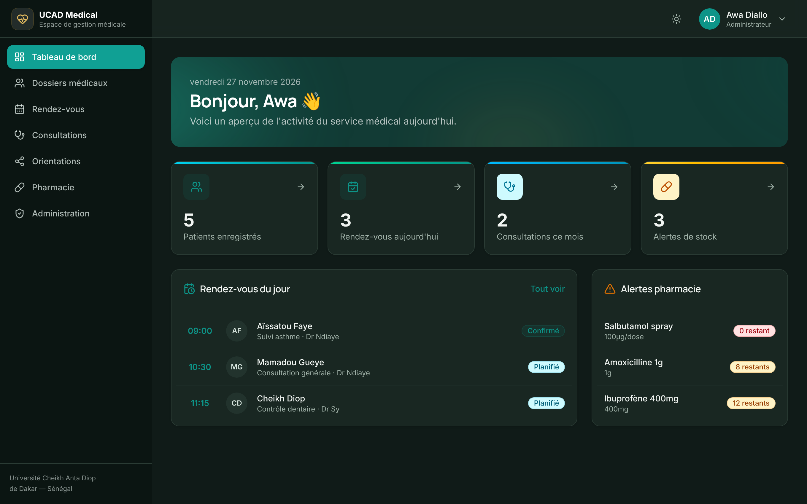 | 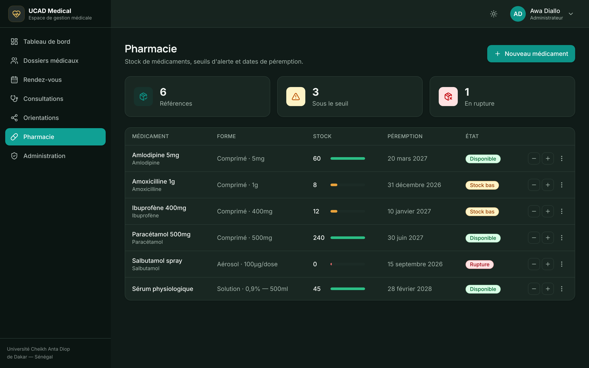 | 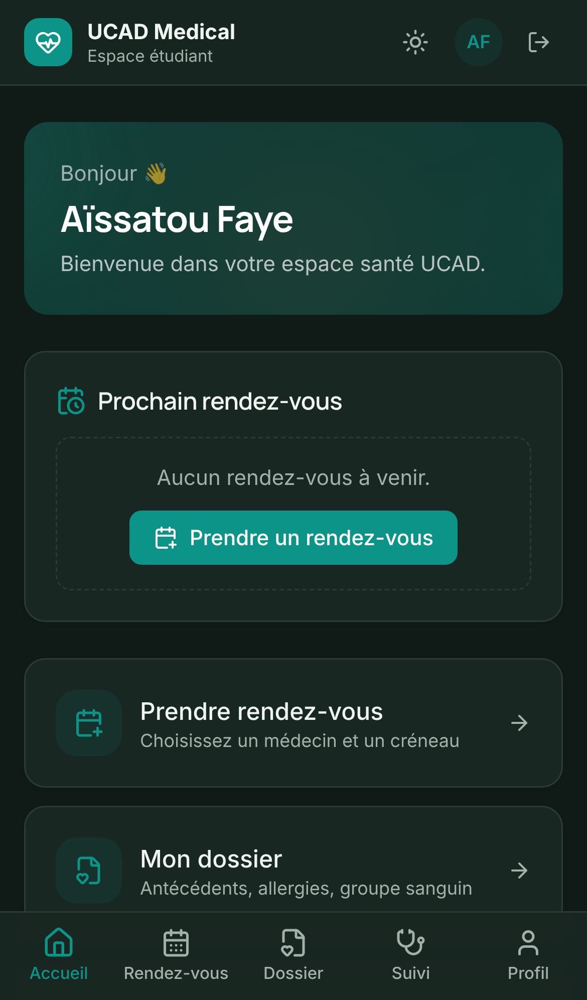 |

---

## 🧩 Fonctionnalités

### Espace personnel

| Module | Description |
| --- | --- |
| **Tableau de bord** | Statistiques en direct, rendez-vous du jour, alertes de stock pharmacie |
| **Dossiers médicaux** | Création/édition des fiches patients : antécédents, allergies, groupe sanguin, historiques de consultations et de rendez-vous, recherche |
| **Rendez-vous** | Planification, filtres, gestion des statuts, regroupement par jour, démarrage de consultation |
| **Consultations** | Création/édition avec constantes vitales (poids, tension, température, pouls), symptômes, diagnostic, traitement |
| **Orientations** | Redirections vers spécialistes / structures externes, suivi du statut |
| **Pharmacie** | Catalogue de médicaments (CRUD), seuils d'alerte, ruptures, dates de péremption, ajustement rapide de stock |
| **Administration** | Gestion des comptes et rôles (créer, modifier, activer/désactiver, supprimer, réinitialiser le mot de passe), statistiques système |

### Espace étudiant (PWA mobile)

- 📅 **Prendre un rendez-vous** en ligne (choix du médecin et du créneau), le voir et l'**annuler**
- 📋 **Consulter son dossier médical** (antécédents, allergies, groupe sanguin) en lecture seule
- 🩺 **Suivre** ses consultations et orientations
- 👤 **Gérer son profil** : coordonnées et changement de mot de passe
- 📲 **Installable** sur l'écran d'accueil (manifeste + service worker, usage hors-ligne léger)
- 🔑 Comptes **créés par le personnel** et liés au dossier patient

---

## 🎨 Design & expérience

Direction artistique **« Premium Institutional Healthcare »** : une interface élégante, rassurante et professionnelle.

- **Palette de marque** : **UCAD Forest** `#123B35` (institutionnel), **Medical Emerald** `#087F72` (actions) et **UCAD Gold** `#D5A84B` (signature premium, utilisé avec parcimonie) — pensée pour l'**accessibilité (WCAG)**.
- **Thème clair & sombre** avec mémorisation de la préférence (tokens CSS, sans flash au chargement).
- Typographie **Manrope** (titres) + **Inter** (contenus), interface **100 % en français**.
- **Animations sur-mesure (CSS, sans dépendance)** : arrière-plans *aurora* animés, dégradés mouvants, compteurs animés, révélations au défilement, effets de survol — avec respect de `prefers-reduced-motion`.
- Entièrement **responsive** ; l'espace étudiant est **mobile-first** façon application native.

---

## 🔒 Sécurité

- **Contrôle d'accès par rôle** (ADMIN, MÉDECIN, PHARMACIEN, INFIRMIER, SECRÉTAIRE, ÉTUDIANT) vérifié côté serveur.
- Mots de passe hachés avec **bcrypt** ; **comparaison à temps constant** à la connexion.
- **Sessions signées** (HMAC) en cookies **httpOnly / secure / sameSite**.
- **En-têtes de sécurité** : `Content-Security-Policy`, `HSTS`, `X-Frame-Options`, `X-Content-Type-Options`, `Referrer-Policy`, `Permissions-Policy`.
- **Protection anti-force-brute** sur la connexion (limitation par IP + email).
- **Validation stricte** des entrées avec **Zod** ; `SESSION_SECRET` obligatoire en production.

---

## 🛠️ Stack technique

- **Next.js 16** — App Router, **Server Actions**, React Server Components
- **React 19** · **TypeScript**
- **Tailwind CSS v4**
- **Prisma 6** + **SQLite** (développement) — basculable vers **PostgreSQL** en production
- **Zod** (validation) · **bcryptjs** (mots de passe)
- **PWA** (manifeste, service worker, icônes)
- Tests **end-to-end** avec **Playwright** · **ESLint**

---

## 🚀 Démarrage

> **Prérequis :** Node.js 20+.

```bash
# 1. Installer les dépendances
npm install

# 2. Configurer la base de données
cp .env.example .env          # DATABASE_URL="file:./dev.db" (+ SESSION_SECRET)
npm run db:push               # crée le schéma
npm run db:seed               # données de démonstration (dont un compte étudiant)

# 3. Lancer le serveur de développement
npm run dev                   # → http://localhost:3000
```

> 💡 `npm run dev` utilise **Webpack** (compatible Windows). `npm run dev:turbo` active Turbopack là où il fonctionne.

### Comptes de démonstration

| Rôle | Email | Mot de passe |
| --- | --- | --- |
| Administrateur | `admin@ucad.edu.sn` | `passer123` |
| Médecin | `medecin@ucad.edu.sn` | `passer123` |
| Pharmacien | `pharmacie@ucad.edu.sn` | `passer123` |
| **Étudiant** | `aissatou.faye@ucad.edu.sn` | `passer123` |

---

## 📁 Structure du projet

```
src/
├── app/
│   ├── (app)/                  # espace personnel (sidebar + topbar)
│   │   ├── tableau-de-bord/
│   │   ├── patients/           # dossiers médicaux (CRUD)
│   │   ├── rendez-vous/
│   │   ├── consultations/
│   │   ├── orientations/
│   │   ├── pharmacie/
│   │   └── administration/     # gestion des utilisateurs & rôles
│   ├── espace-etudiant/        # espace étudiant (PWA mobile)
│   │   ├── rendez-vous/
│   │   ├── dossier/
│   │   ├── consultations/
│   │   └── profil/
│   ├── actions/                # Server Actions (auth, patients, rendez-vous, étudiant…)
│   ├── login/                  # connexion
│   ├── manifest.ts             # manifeste PWA
│   └── page.tsx                # accueil public
├── components/                 # composants UI et métier
└── lib/                        # prisma, session, autorisation, utils, constantes
prisma/
├── schema.prisma               # modèle de données
└── seed.ts                     # données de démonstration
public/                         # icônes PWA, service worker
```

---

## 🧪 Qualité

```bash
npm run build     # build de production
npm run lint      # analyse statique (ESLint)
```

Le projet a été validé par un **parcours end-to-end au navigateur** (Playwright), sur desktop et mobile :
connexion par rôle, CRUD des dossiers, prise de rendez-vous, création d'accès étudiant et contrôle d'accès.

---

## 🌍 Passage en production (PostgreSQL)

Dans `prisma/schema.prisma`, remplacer le provider par `postgresql`, définir `DATABASE_URL` vers votre
instance et un `SESSION_SECRET` fort (`openssl rand -base64 48`), puis `npm run db:push`.

---

<div align="center">

Projet réalisé pour le service médical de l'**Université Cheikh Anta Diop de Dakar** — Sénégal.

</div>
